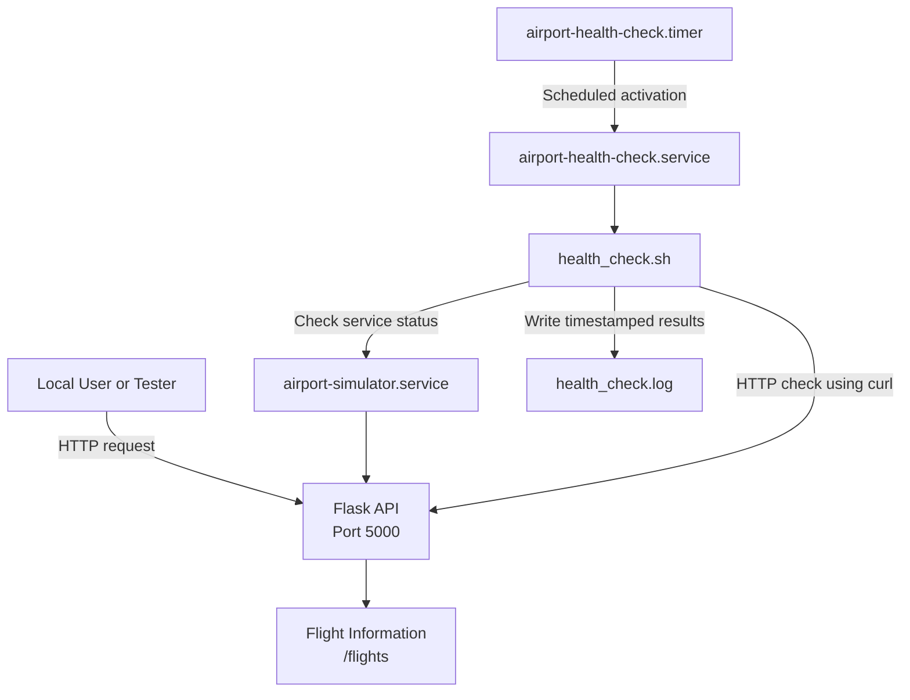

# Airport Operations Simulator — Architecture

## Overview

The Airport Operations Backend Simulator runs on Rocky Linux and serves fictional flight information through a Python Flask API. A systemd service manages the application, while a Bash script checks service and HTTP availability. A systemd timer schedules recurring health checks, and the script records timestamped results in a log file.

## Architecture Diagram

## Component Responsibilities

| Component | Responsibility |
|---|---|
| Rocky Linux | Hosts the application and automation |
| Python and Flask | Serves the API and flight information |
| `airport-simulator.service` | Runs the application as a background service |
| `airport-health-check.timer` | Schedules recurring health checks |
| `airport-health-check.service` | Executes the health-check script |
| `health_check.sh` | Checks service status and HTTP response |
| `health_check.log` | Stores timestamped health-check results |

## Health-Check Workflow

1. The systemd timer reaches its scheduled activation time.
2. The timer activates `airport-health-check.service`.
3. The service runs `health_check.sh`.
4. The script checks whether the simulator service is active.
5. The script uses `curl` to test the local HTTP endpoint.
6. The script records the results in the health-check log.
7. The script exits with status `0` on success or `1` when a check fails.

## Notes

- The application currently uses fictional flight data.
- The API listens on localhost at `127.0.0.1:5000`.
- This is an educational home-lab project, not a real airport operations system.
